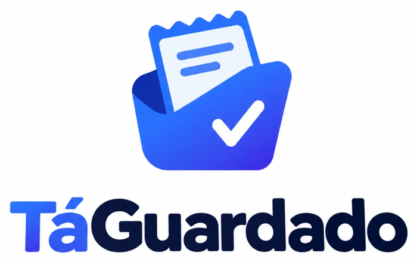

<p align="center">
  
</p>

# TáGuardado

Organizador de notas fiscais e garantias. Consumidores perdem comprovantes e não lembram até quando
um produto está na garantia. Este projeto guarda notas, fotos e documentos, mostra o que está
vencendo e responde dúvidas sobre garantias e direitos do consumidor.

É também um **projeto de estudo** de LLM, RAG e agentes, feito passo a passo.

## O que já faz

- Cadastro de produtos com categoria, foto e documentos (nota fiscal, termo de garantia, manual)
- Leitura da nota fiscal por IA (QR code, chave de acesso e consulta do CNPJ)
- Prazo de garantia, vencimento, resumo por status e busca (por texto e por significado)
- Chat que responde com o Código de Defesa do Consumidor, com o termo de cada produto (RAG) e com
  consultas ao cadastro (agente com ferramentas)
- Avaliação medida do chat (`avaliacao/`)

## Stack

- Python 3.12+ com gerenciador `uv`
- Streamlit (interface) e SQLite (dados e vetores)
- Ollama local (`llama3.2:3b`, `qwen2.5vl:3b`, `bge-m3`), com o Claude (Anthropic) como provedor
  alternativo, trocado por `LLM_PROVIDER` no `.env`

## Como rodar

```bash
uv sync
cp .env.example .env     # ajuste os modelos; a chave da Anthropic só é necessária com o Claude
uv run pytest
uv run streamlit run src/garantiafacil/app.py
```

Para medir o chat: `uv run python -m avaliacao.rodar` (leva de 15 a 20 minutos com o modelo local).

## Documentação

- [Roteiro de estudo](docs/roteiro.md)
- [Próximos passos](docs/proximos-passos.md)
- Avaliações: [leitura de notas](docs/avaliacao-extracao.md), [RAG](docs/avaliacao-rag.md),
  [agente](docs/avaliacao-agente.md) e [chat](docs/avaliacao-chat.md)

> O nome do pacote Python continua `garantiafacil` (nome original do projeto).
